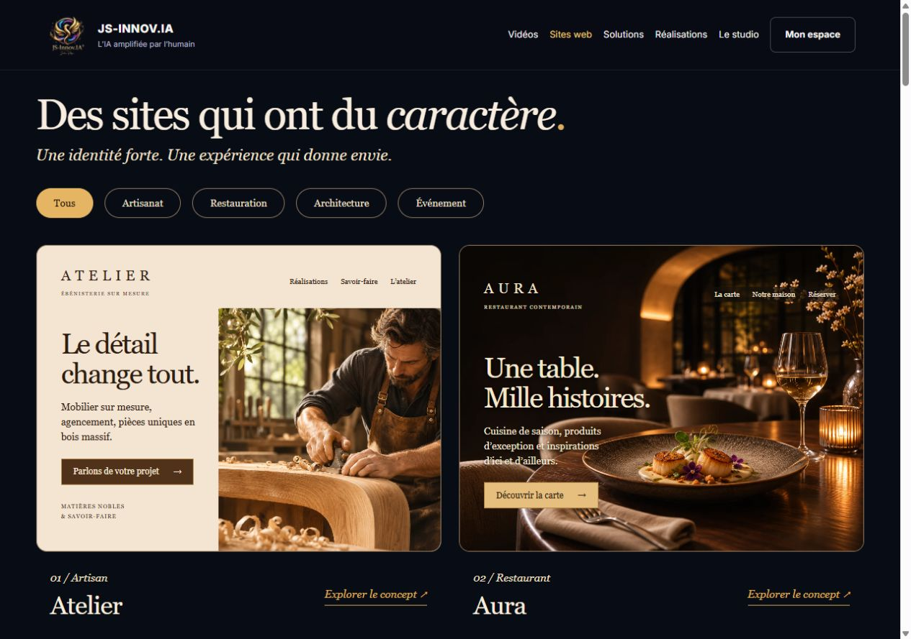
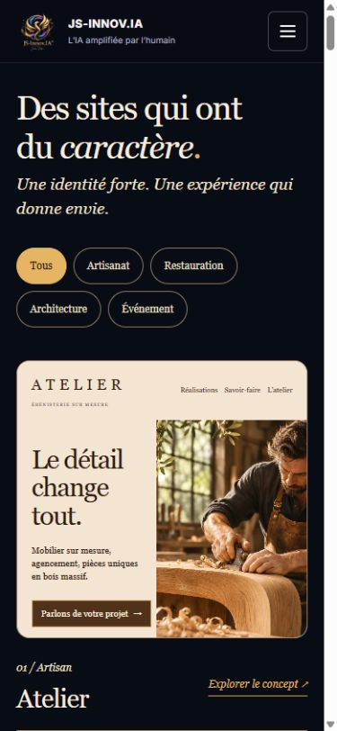
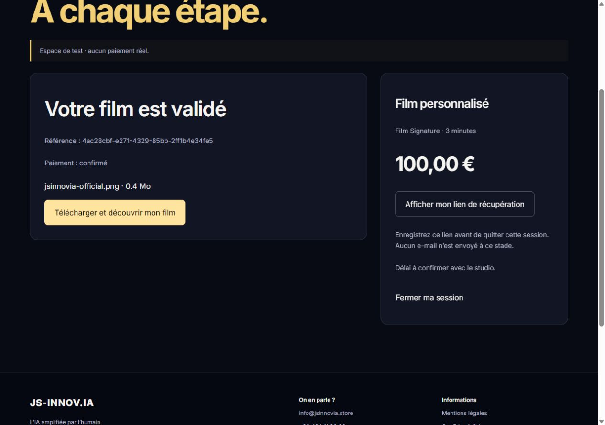

# JS-Innov.IA — audit et refonte en branche isolée

Vérifications du 12 novembre 2026. Branche `codex/video-commerce-test-20261112`, issue de `Julien218/js-innov.ia` à `1da347c`. Aucune fusion, aucun déploiement, aucun paiement réel.

## Ce qui existait réellement

| Élément | Constat vérifié | Limite |
|---|---|---|
| Site public JS-Innov.IA | Accueil, Web Studio, Studio Créatif, packs, agents, formulaires, portfolio et pages légales existent. | Deux navigations et plusieurs parcours commerciaux cohabitent. |
| Commande publique de films 1 / 3 minutes | Aucune implémentation correspondante retrouvée dans la branche principale du site, ses PR ou ses branches identifiées. | Une page générique Checkout et une commande de sites web ne constituent pas cette livraison. |
| Studio Créatif | La [PR 21](https://github.com/Julien218/js-innov.ia/pull/21) a été fusionnée ; la page présente des prestations créatives. | Les offres observées concernent notamment des vidéos courtes publicitaires ; aucun configurateur de films-souvenirs 1 / 3 minutes n’a été observé. |
| Ancien Checkout | Le code contient des champs de carte et un traitement simulé. À panier vide, le navigateur revient à la boutique musicale. | Ce n’est pas une intégration Stripe opérationnelle. |
| Cockpit : vidéos clients | La branche [feature/videos-clients](https://github.com/Julien218/js-innov.ia-cockpit/tree/feature/videos-clients) existe et possède un commit d’avance sur `main` lors de l’inspection. | Pas de PR associée retrouvée ; déploiement de cette branche non attesté. |
| Circuit interne existant | Code de dépôt authentifié, médias privés, contrat de worker, relecture interne, validation client et publication sociale. | Aucun raccord Stripe public trouvé. Le code attend un worker de montage externe ; sa production réelle n’est pas prouvée par la présence des routes. |
| Travail transmis dans la conversation | La conversation précédente annonce explicitement une transmission à Codex. | Elle n’apporte aucune preuve de livraison, de test Stripe ou de page publique. |

**Conclusion : le chantier n’était pas livré au public. Une partie du circuit vidéo interne existe bien en branche et doit être prise en compte avant toute intégration de production.**

L’extraction de tests du circuit Cockpit a validé 7 règles unitaires. Son test d’intégration WhatsApp n’est pas concluant dans cette extraction partielle du runtime ; ce résultat ne doit pas être présenté comme une vérification de production ni comme un diagnostic définitif du module complet.

## Audit du site public

Les pages publiques ont été parcourues sans soumettre de demande réelle ni modifier de compte. Les contrôles couvrent le code, les branches/PR, les réponses HTTP, les pages rendues et les parcours principaux. Ils ne constituent pas un test d’intrusion ni une certification d’accessibilité.

| Domaine | Problème observé | Réponse dans cette branche |
|---|---|---|
| UX et navigation | Accueil SaaS et pages historiques utilisent des navigations différentes. | Navigation et pied de page communs sur les pages publiques ; accès aux films, sites, solutions, réalisations, studio et espace vidéo. |
| Conversion | La vidéo personnalisée n’a pas de parcours dédié ; plusieurs tarifs de sites cohabitent. | Deux fiches de films, configurateur et commande test. Anciennes routes Checkout, Commande et Pricing réorientées vers les parcours appropriés. |
| Marque | Signatures variables ; logo de la barre peu lisible ; plusieurs assistants superposés. | Logo 800 px fourni par le propriétaire, variantes web, signature « L’IA amplifiée par l’humain », navigation harmonisée. L’ouverture automatique du chat a été retirée. |
| Elynea | Deux fichiers WebP ont un contenu binaire illisible. L’image est cassée dans le navigateur. | Fichiers remplacés par une version lisible d’un emblème existant du Cockpit ; cache renouvelé. Aucun nouveau portrait humain n’a été inventé. Le modèle 3D reste désactivé. |
| Galerie de sites | Les aperçus principaux utilisent des compositions abstraites. | Galerie Atelier / Aura inspirée de la référence fournie, photographies IA de démonstration, filtres et aperçus interactifs. |
| Références locales | Clients, outils et partenaires risquent d’être confondus. | Réalisations et écosystème identifiés séparément. Aucun partenariat contractuel inventé. |
| Réseaux | Réseaux officiels insuffisamment reliés. | YouTube `@Js-innovia` et TikTok `@villeconnecteos`, vérifiés ; pages Réseaux et Réalisations, liens dans le pied de page. |
| SEO technique | `robots.txt` et `sitemap.xml` renvoient le HTML de l’accueil ; les URL inexistantes répondent 200. | Fichiers servis avec les bons types, sitemap de pages publiques, vraie réponse 404, pages privées exclues de l’indexation. |
| Contenus et découverte IA | Informations essentielles dépendantes du chargement JavaScript. | Contenu initial lisible dans la réponse HTML, pages éditoriales, liens internes, métadonnées, canonicals, Organization, WebSite, WebPage/Article et fil d’Ariane. |
| Performance | Dépendance à des images externes pour l’identité ; bundles 3D et applicatifs importants. | Identité locale compressée, photos de concepts en WebP, absence de lecteur YouTube chargé automatiquement. Les gros bundles historiques restent à optimiser. |
| Sécurité | Ancien formulaire de carte simulé ; données et étapes de commande non sécurisées par un vrai paiement serveur. | Formulaire de carte local retiré. Checkout hébergé Stripe, prix imposés côté serveur, webhook signé, contrôle du montant et de la devise, rejet des clés réelles. |
| Fiabilité du contact | Une erreur réseau peut laisser le formulaire en attente ; un préremplissage mal formé peut casser la page. | Gestion d’erreur et remise à disposition du formulaire ; parsing protégé ; VilleConnect et les partenariats arrivent dans un formulaire adapté. |

Pages observées : accueil, CreativeStudio, Web Studio, saas-packs, saas-agents, saas-contact, CGV, confidentialité, Partners, AIMusic, MusicShop, Showcase, Automations, Applications, Blog, News, Templates, Contact, Pricing, Visuels, Commande, Cart, saas-analyse, saas-devis et comportement de Checkout. L’espace client historique redirige vers le Cockpit ; son compte authentifié n’a pas été audité.

### Parcours et captures

1. **Accueil public — améliorable.** Proposition générale, plusieurs destinations et superposition de guides ; pas d’achat de film identifiable.
2. **Offres historiques — améliorable.** Studio Créatif présent, mais prestations différentes de la demande de films-souvenirs.
3. **Web Studio — refondu localement.** Galerie éditoriale avec deux concepts photographiques ; les 18 concepts interactifs existants restent explorables.
4. **Configurateur — vérifié localement.** Durée, événement, ambiance, format, brief et coordonnées de démonstration.
5. **Dépôt privé — vérifié localement.** Fichier envoyé, dossier confirmé et verrouillé ; accès isolé par commande.
6. **Stripe — vérifié en sandbox.** Commande Signature de 100 €, carte de test Stripe, retour vers le site et confirmation serveur par webhook.
7. **Relecture interne — vérifiée localement.** Un résultat déposé reste inaccessible au client avant approbation interne.
8. **Validation client et téléchargement — vérifiés localement.** Validation dans le navigateur, téléchargement, empreinte du fichier identique à celle de l’original de démonstration.
9. **Mobile — vérifié par viewport.** Treize pages contrôlées à 390 px, largeur utile 375 px : aucun débordement horizontal, un H1, aucune image cassée observée. Menu, filtres et démo testés.

## Pages créées ou enrichies

| Adresse | Fonction |
|---|---|
| `/` | Accueil orienté offres, créations et ancrage à Dour. |
| `/web-studio` | Galerie inspirée de la référence, filtres et personnalisation existante. |
| `/videos` | Deux formules, fonctionnement, limites et questions pratiques. |
| `/videos/video-1` | Essentiel : 1 minute, 49,99 €. |
| `/videos/video-3` | Signature : 3 minutes, 100 €. |
| `/commander-video` | Brief et création de l’espace privé de test. |
| `/espace-video` | Médias, paiement, suivi, ajustements, validation et téléchargement. |
| `/studio-review` | Relecture interne de test, protégée côté serveur. |
| `/solutions` | HainoFlow, Signelya et VilleConnect OS. |
| `/ecosysteme` | Répertoire des solutions et sites de référence. |
| `/realisations` | Quatre créations YouTube vérifiées via oEmbed. |
| `/reseaux` | Chaîne JS-Innov.IA et compte TikTok VilleConnect OS. |
| `/le-studio` | Positionnement, méthode et relation avec Julien. |
| `/guides/preparer-sa-video` | Choix des médias, ordre, brief, formats et autorisations. |
| `/guides/site-web-local` | Informations, parcours et visibilité d’un site local. |
| `/partenaires` | Références, écosystème et proposition de partenariat. |

Les autres prix ne sont pas inventés. Le traitement fiscal, le périmètre des retouches et les conditions de vente de films doivent être précisés avant ouverture réelle. Les 24 h ne sont pas garanties : le délai sera confirmé selon le dossier et la capacité du studio.

### Liens externes

- YouTube : [JS-Innov.IA](https://www.youtube.com/@Js-innovia).
- TikTok : [VilleConnect OS](https://www.tiktok.com/@villeconnecteos), profil observé dans le navigateur et cohérent avec Dour.
- [VilleConnect OS](https://villeconnectos.com/) : page accessible dans le navigateur ; un client HTTP automatisé reçoit 403.
- [HainoFlow](https://hainoflow.jsinnovia.com/) et [Signelya](https://signelya.jsinnovia.com/) : réponses HTTP 200.
- Synergie Dour, Miss & Mister Dour et Fashionist’ART : réponses HTTP 200.
- Olivier Trévis : l’adresse utilisée par le site public renvoie 404 lors du contrôle. Retirée du nouveau répertoire en attendant une adresse vérifiée.

Les liens depuis JS-Innov.IA sont implémentés. Les autres sites n’ont pas été modifiés ; des liens retour supplémentaires ne sont donc pas prétendus livrés. Aucun profil Facebook ou Instagram n’a été ajouté faute d’adresse officielle confirmée.

## Résultats des vérifications

- **76 tests automatisés réussis.** Cycle de commande, prix, limites, isolation, autorisations, webhooks signés, doublons, absence de livraison avant paiement, approbations, retouches, persistance, découverte publique et images.
- **Build réussi**, vérification TypeScript réussie, contrôle des images Elynea réussi.
- **Lint : aucune erreur**, 37 avertissements restant dans le code historique.
- **Audit des dépendances de production : aucune vulnérabilité signalée** au moment du contrôle, après mises à jour de follow-redirects et Zod.
- **Paiement Stripe réellement exécuté en sandbox indépendante**, avec la carte publique de test 4242. Aucun débit réel. La confirmation vient du webhook signé, pas du retour du navigateur.
- **Validation interne puis client et téléchargement réellement parcourus**, avec un MP4 de démonstration de 3 secondes créé localement. Ce fichier ne constitue pas un film client de 3 minutes ni une preuve de montage par Elynea.
- Robots en `text/plain`, sitemap en XML, canonicals propres, contenu éditorial dans le HTML, 404 et en-têtes de non-indexation privés vérifiés en HTTP local.

L’environnement Stripe temporaire créé pour ces essais expire le 19 novembre 2026. Ses accès sont uniquement dans le dossier privé local ignoré par Git et Docker. Il ne remplace pas le raccordement à un sandbox durable du compte de l’entreprise.

Les mesures HTTP publiques ont observé environ 0,2 à 0,6 s pour les petites réponses HTML de cette série. Ce n’est pas une mesure de chargement complet. Aucun score Lighthouse, Core Web Vitals de terrain, audit de lecteur d’écran ou test sur téléphone physique n’est revendiqué.

## Intégration Cockpit : point de passage obligatoire avant production

Le serveur de cette branche fournit un **circuit isolé de test** avec stockage privé local, file et revue interne. Il n’a pas été activé comme un deuxième service en production.

La branche Cockpit `feature/videos-clients` doit devenir la base du raccordement de production après revue. Le storefront devra lier ses commandes à ses projets et tâches sans réutiliser les projets d’autres clients. Le contrat du worker, l’identité des clients, les droits sur les médias et la reprise sur erreur doivent être validés ensemble.

Le module interne existant prévoit une publication sociale automatique après validation. Cette logique ne doit pas être appliquée aux films privés de particuliers. Aucun ordre de publication, message WhatsApp ou e-mail n’a été envoyé pendant ce travail.

Restent à raccorder et à tester :

1. L’entrée authentifiée des commandes payées dans le circuit Cockpit existant, avec idempotence et séparation des clients.
2. Le worker de montage réel, ses capacités, ses coûts et ses délais.
3. Le retour de la version relue dans l’espace client et le traitement des retouches.
4. Les e-mails et liens de récupération, leur réception effective et leur révocation/expiration.
5. Le stockage de production, la rétention et les sauvegardes, les quotas et le contrôle approfondi des médias. Le stockage SQLite local convient à cette démonstration mono-instance, pas à une plateforme multi-instance sans adaptation.
6. Les conditions commerciales, le traitement fiscal et une éventuelle offre 24 h mesurée.

Ces points empêchent de présenter la plateforme comme prête à vendre en production. Aucun déploiement ou paiement réel ne doit être effectué sans validation explicite.

## Visibilité dans les moteurs et les assistants IA

Les contenus, liens, métadonnées et informations d’organisation ont été renforcés. Il n’existe pas de garantie d’apparition dans toutes les IA, ni de balisage magique assurant une citation. Le suivi dans les outils propriétaires des moteurs restera à effectuer après une publication autorisée.

Références : [guide Google sur la recherche générative](https://developers.google.com/search/docs/fundamentals/ai-optimization-guide), [fonctionnalités IA et sites web](https://developers.google.com/search/docs/appearance/ai-features), [création de Checkout Sessions Stripe](https://docs.stripe.com/api/checkout/sessions/create), [vérification et traitement des webhooks](https://docs.stripe.com/events/manage-webhook-endpoints).
